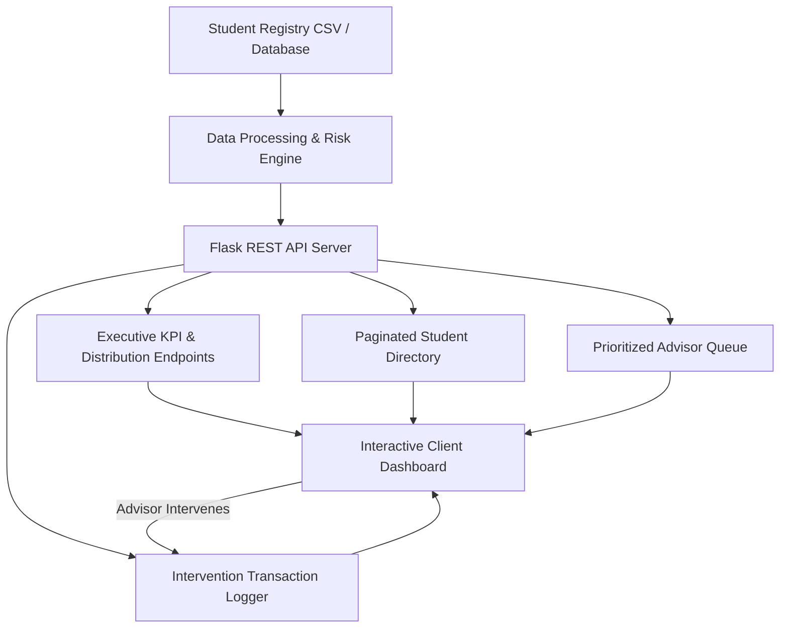

# 🎓 Student Success & Intervention Engine (SS&IE)

[](https://python.org)
[](https://flask.palletsprojects.com/)
[](https://pandas.pydata.org/)
[](https://www.chartjs.org/)
[](LICENSE)

An intelligent, full-stack institutional analytics and early-intervention platform designed to detect academic risk early, analyze multidimensional behavioral signals (GPA, attendance velocity, LMS engagement), and coordinate prioritized advisory interventions.

---

## 🌟 Key Highlights & Capabilities

- 📊 **Executive Overview Dashboard**: Real-time KPI telemetry (managed students, GPA benchmarks, attendance rates, high-risk trigger states, and advisor queue sizing).
- 📈 **Interactive Visual Analytics**:
  - **Inference Category Distribution**: Categorical risk breakdown (High, Medium, Low).
  - **Academic GPA Allocation Stratum**: Distribution across academic thresholds.
  - **Multivariate Correlation Matrix**: Live interactive scatter plotting class attendance versus cumulative GPA.
- 🗂️ **Student Registry & Directory**: Searchable, filterable, and paginated directory with multi-column sorting (Student ID, Risk Probability, GPA, Attendance, LMS Logins, Interactions).
- 🚨 **Advisor Priority Queue**: Algorithmic triage ranking students into priority buckets (`CRITICAL`, `HIGH`, `ELEVATED`) with granular diagnostic risk warnings.
- 📝 **Intervention Audit Log & Modal Workflow**: Fast action recording (academic advising, tutoring referrals, attendance warnings, wellness outreach) with live audit history.
- ⚙️ **Explainable Engine Diagnostics**: Feature weight transparency detailing how predictive indicators influence risk scores.

---

## 🏗️ System Architecture



---

## 📁 Repository Structure

```plaintext
student-success-engine/
├── .env.example          # Environment variable template
├── .gitignore            # Git ignore rules (protects credentials & venv)
├── app.py                # Main Flask backend application & REST API
├── generate_data.py      # Synthetic student dataset generator
├── requirements.txt      # Python dependencies
├── students_data.csv     # 500-student dataset (GPA, Attendance, LMS, Risk)
├── static/
│   ├── css/
│   │   └── style.css     # Bespoke UI design system & responsive styling
│   └── js/
│       └── script.js     # Dashboard state, Chart.js integrations & API handlers
└── templates/
    └── index.html        # Single-page application UI template
```

---

## 🚀 Quick Start & Installation

### 1. Clone the Repository

```bash
git clone https://github.com/abhinavsingh77057-crypto/student-success-engine.git
cd student-success-engine
```

### 2. Set Up Virtual Environment

#### Windows (PowerShell):
```powershell
python -m venv venv
.\venv\Scripts\Activate.ps1
```

#### macOS / Linux:
```bash
python3 -m venv venv
source venv/bin/activate
```

### 3. Install Dependencies

```bash
pip install -r requirements.txt
```

### 4. Configure Environment Variables

Create your local `.env` file from the provided template:

```bash
# Windows PowerShell
Copy-Item .env.example .env

# macOS / Linux / Git Bash
cp .env.example .env
```

Your `.env` file should look like this:

```env
FLASK_APP=app.py
FLASK_ENV=development
FLASK_DEBUG=True
PORT=5000
SECRET_KEY=ssie-secure-secret-key-development-2026
CSV_DATA_PATH=students_data.csv
```

> **Note:** `.env` is automatically ignored by `.gitignore` to prevent leaking secrets.

### 5. Generate / Refresh Dataset (Optional)

To generate a fresh synthetic cohort of 500 students with realistic correlated distributions:

```bash
python generate_data.py
```

### 6. Run the Application

```bash
python app.py
```

Open your browser and navigate to:
```
http://localhost:5000
```

---

## 📡 REST API Reference

| Method | Endpoint | Description |
| :--- | :--- | :--- |
| `GET` | `/` | Web application portal interface |
| `GET` | `/api/metrics` | Executive KPIs, risk breakdown, GPA histogram, and scatter points |
| `GET` | `/api/data` | Baseline summary metrics (backward-compatible) |
| `GET` | `/api/students` | Paginated directory (`?page=1&limit=10&search=1005&risk=HIGH&sort_by=gpa&sort_order=desc`) |
| `GET` | `/api/student/<id>` | Full diagnostic profile and historical logs for a student |
| `GET` | `/api/queue` | Prioritized intervention queue for academic advisors |
| `GET` | `/api/history` | Logged intervention records (`?student_id=1003&status=Completed`) |
| `POST`| `/api/intervene` | Submit new intervention action (`{ student_id, action_type, advisor, notes, status }`) |
| `GET` | `/api/analytics` | Machine learning engine accuracy, latency, and feature importances |

---

## 🔒 Security & Best Practices

- **Never commit `.env`**: Environment configuration files containing credentials, tokens, or custom keys are excluded from git version control via `.gitignore`.
- **Reproducible setups**: Always maintain `.env.example` as a template for team onboarding.
- **Dependency isolation**: Virtual environments (`venv/`) are isolated and excluded from commits.

---

## 📄 License

This project is licensed under the [MIT License](LICENSE).
